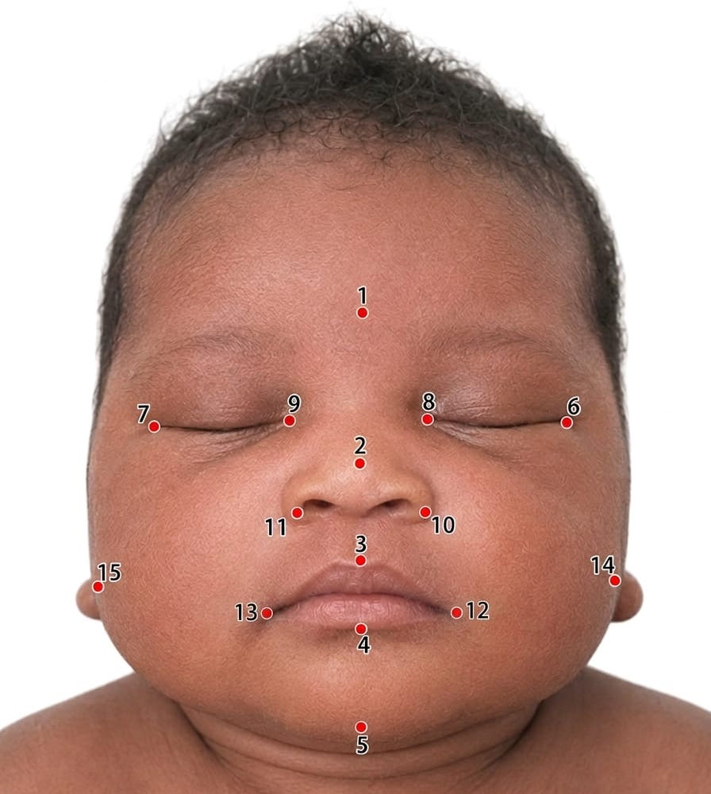
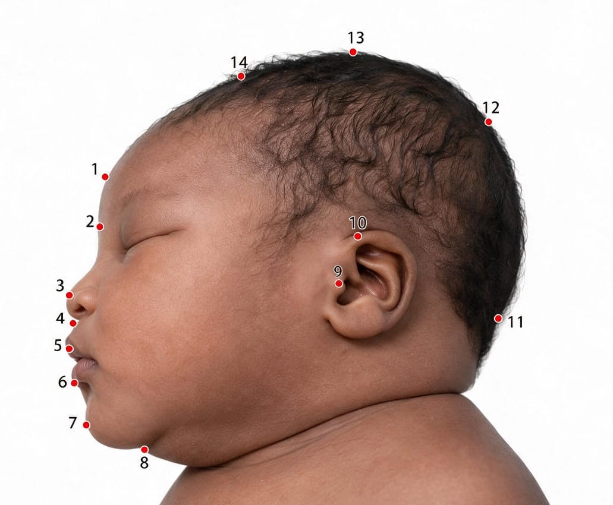

```{r setup, include=FALSE}
knitr::opts_chunk$set(
  echo = FALSE, 
  warning = FALSE, 
  message = FALSE, 
  cache = FALSE,
  fig.align = "center",
  fig.width = 8,
  fig.height = 6,
  out.width = "100%"
)

# Load mandatory frameworks into the active RStudio session
library(geomorph)
library(readxl)
library(dplyr)
library(tidyverse)
library(tidymodels)
library(glmnet)
library(pROC)
library(broom)
library(car)
library(vip)
library(gridExtra)
library(ggrepel)
library(flextable)

set.seed(42)
N_PERM <- 9999

# ----------------------------------------------------------------------------
# Reusable helper for publication-ready tables, styled consistently.
# ----------------------------------------------------------------------------
make_pub_table <- function(df, footnote_text = NULL, align_cols = NULL, max_width_in = 6.5) {
  ft <- flextable(df)
  ft <- theme_booktabs(ft)
  ft <- bold(ft, part = "header")
  ft <- align(ft, align = "center", part = "header")
  if (!is.null(align_cols)) {
    ft <- align(ft, j = align_cols, align = "center", part = "body")
  }
  ft <- fontsize(ft, size = 9, part = "all")
  ft <- padding(ft, padding = 3, part = "all")
  ft <- line_spacing(ft, space = 1, part = "all")
  if (!is.null(footnote_text)) {
    ft <- add_footer_lines(ft, values = footnote_text)
    ft <- fontsize(ft, size = 8, part = "footer")
    ft <- italic(ft, part = "footer")
  }
  ft <- autofit(ft)
  # fit_to_width() shrinks the font to fit a fixed page width -- that's a
  # print-only concept. Only apply it when actually rendering to Word;
  # HTML has no physical page, so let every table keep its full, natural
  # font size there (wide tables just get a horizontal scrollbar).
  if (isTRUE(knitr::pandoc_to("docx"))) {
    ft <- fit_to_width(ft, max_width = max_width_in)
  }
  ft
}

# ----------------------------------------------------------------------------
# One p-value formatter for the whole manuscript (text AND tables).
# 4 decimals, matching the tables; anything below 0.001 prints as "< 0.001".
#   fmt_p(0.0004)            -> "< 0.001"
#   fmt_p(0.0341)            -> "= 0.0341"
#   fmt_p(0.7998)            -> "= 0.7998"
#   fmt_p(x, eq = FALSE)     -> "0.0341"   (for table cells)
#   fmt_p(x, eq = FALSE, star = TRUE) -> "0.0341*"
# Never rounds a small p to 0 and never falls into scientific notation.
# ----------------------------------------------------------------------------
fmt_p <- function(p, digits = 4, threshold = 0.001, eq = TRUE, star = FALSE) {
  p <- suppressWarnings(as.numeric(p))
  out <- ifelse(
    is.na(p), "\u2014",
    ifelse(p < threshold,
           paste0("< ", formatC(threshold, format = "fg")),
           paste0(if (eq) "= " else "", formatC(p, format = "f", digits = digits)))
  )
  if (star) out <- ifelse(!is.na(p) & p < 0.05, paste0(out, "*"), out)
  out
}
```

```{r data_ingestion, message = FALSE, warning = FALSE, results = 'hide'}
# Moved up from the Methods section so the abstract can use computed values
suppressWarnings(source("data_ingestion.R"))
suppressWarnings(source("primary_gm_analysis_geomorph.R"))
suppressWarnings(source("build_master_dataset_geomorph.R"))
suppressWarnings(source("measurement_error.R"))
source("traditional_anthropometric_regression.R")
suppressWarnings(source("confounder_controlled_shape_analysis.R"))
source("size_analysis.R")
source("allometry_controlled_shape_analysis.R")
source("reviewer_response_analyses.R")   # interaction test, size-covariate sensitivity, PC-retention, slope CIs, gestational age
source("landmark_exclusion_sensitivity.R")   # sensitivity to the most error-prone landmarks (zygion, opisthocranion)
source("transformation_grid.R")
source("error_bubble_plot.R")
source("participants_characteristics.R")
# short-hand for regression p-values
reg_p <- function(v) clinical_table$p_value[clinical_table$Variable == v]
```

**ABSTRACT**

**Objectives:** Human parturition reflects the “obstetrical dilemma” between fetal cranial form and maternal pelvic constraints. Current CPD assessment relies on pelvimetry and linear fetal head measurements, capturing size but not shape. We tested the hypothesis that neonatal craniofacial shape, independent of size, is associated with CPD case status, comparing anthropometry with geometric morphometric (GM) shape analysis, both measured postnatally in a Nigerian cohort.

**Methods:** In a case-control study, 160 neonates (80 CPD cases delivered by emergency caesarean section; 80 uncomplicated vaginal deliveries) were recruited. Standardised anterior (15-landmark) and lateral (14-landmark) photographs were analysed via geometric morphometrics (Generalised Procrustes Analysis, Principal Component Analysis, Canonical Variate Analysis, Procrustes ANOVA, MANOVA); anthropometric variables' joint association with CPD was assessed by logistic regression.

**Results:** Occipitofrontal diameter (aOR = 1.29, 95% CI 1.11–1.50, *p* `r fmt_p(reg_p("OFD_mm"))`) and birth weight (aOR = 9.36 per kg, 95% CI 1.79–48.93, *p* `r fmt_p(reg_p("Weight_kg"))`) were independently associated with CPD; maternal age was associated with lower odds of CPD (aOR = 0.92, 95% CI 0.85–0.99, *p* `r fmt_p(reg_p("Maternal_Age"))`) (Nagelkerke *R*^2^ = 0.571). After adjustment for maternal covariates and allometry, anterior and lateral craniofacial shape differed significantly between groups (Procrustes ANOVA, *F* = `r sprintf("%.2f", ant_allom_summary["group", "F"])`, *p* `r fmt_p(ant_allom_summary["group", "Pr(>F)"])` and *F* = `r sprintf("%.2f", lat_allom_summary["group", "F"])`, *p* `r fmt_p(lat_allom_summary["group", "Pr(>F)"])`, respectively).

**Conclusions:** Anthropometry and craniofacial shape both differed significantly between CPD and non-CPD neonates, consistent with the hypothesised size-independent shape signal. Because craniofacial shape was measured only after delivery and maternal pelvic morphology was not assessed, these findings should be interpreted as a postnatal, size-independent association between craniofacial shape and CPD case status, not evidence of craniofacial-pelvic integration or a deployable screening tool.

*Keywords: neonatal craniofacial phenotype; geometric morphometrics; craniofacial shape; cephalopelvic disproportion; Procrustes analysis; fetal anthropometry*

# Introduction

The disproportionate difficulty of human childbirth relative to other primates is classically framed as the "obstetrical dilemma": the evolutionary tension between encephalisation, which favours a large fetal head, and bipedal locomotion, which constrains pelvic breadth [@washburn1960tools; @wells2012obstetric]. This trade-off between fetal cranial form and maternal pelvic architecture is a central theme in human biology, and cephalopelvic disproportion (CPD) represents its most acute clinical expression.

Geometric morphometrics (GM) is a well-established quantitative framework in evolutionary biology and physical anthropology, capturing the full geometry of a set of anatomical landmarks after mathematically removing variation due to position, orientation, and scale (Procrustes superimposition), leaving a pure measure of shape that can be statistically compared between groups [@klingenberg2016size; @zelditch2012geometric]. GM approaches have been applied to craniofacial research from syndromic diagnosis to forensic identification, but their application to obstetric risk assessment, and to CPD specifically, remains absent. Traditional obstetric evaluations instead rely on univariate, linear fetal head dimensions (such as biparietal diameter and head circumference), which capture size but ignore spatial shape configuration [@wu2023global; @betran2021trends]. To our knowledge, this is the first GM study of neonatal craniofacial shape in CPD.

CPD occurs when the fetal head is too large, or unfavourably shaped, relative to the maternal pelvis to permit safe vaginal delivery, and remains one of the most common indications for emergency caesarean section worldwide. In low- and middle-income settings, late recognition of CPD contributes to obstructed labour, uterine rupture, and adverse maternal and perinatal outcomes [@acog2020macrosomia]. Assessment relies on pelvimetry and linear fetal head measurements: biparietal diameter (BPD), occipitofrontal diameter (OFD), and head circumference (HC). While useful measures of fetal size, these treat the fetal head as a few linear distances rather than a continuous form, missing localised shape differences. The present study examines craniofacial size and shape measured postnatally, after delivery; because measurements followed labour, it cannot fully distinguish intrinsic morphology from labour-related cranial moulding, and it does not replicate the antenatal ultrasound workflow.

We tested the hypothesis that neonatal craniofacial shape, independent of size, differs between neonates delivered for CPD and those delivered vaginally without complication, and that this difference is not fully explained by fetal size alone; a secondary hypothesis was that this shape signal would be detectable in both an anterior (facial) and a lateral (cranial profile) configuration. This study compares traditional anthropometric measurements with GM analysis of neonatal craniofacial shape, using standardised anterior and lateral photographs obtained after delivery, in a case-control sample of neonates delivered at Jahun General Hospital, Jigawa State, Nigeria.

# Materials and Methods

## Study Design and Setting

This case-control study was conducted at Jahun General Hospital, Jigawa State, Nigeria, from 15 June 2026 to 15 July 2026. Ethical approval (JGHREC/2026/2589) and written informed consent from all participating mothers were obtained.

## Participants

Cases (n = 80) comprised neonates delivered by emergency caesarean section for a clinical diagnosis of CPD, defined using a WHO-style partograph as cervical dilatation crossing the action line (dilatation rate < 1 cm/hour) in the presence of adequate uterine contractions (≥3 contractions per 10 minutes, each lasting ≥45 seconds), grade 2/3 caput moulding, and arrest of descent of the presenting part; diagnoses were made by the attending obstetric team as part of routine clinical care rather than a prospectively documented study protocol. Controls (n = 80) comprised neonates delivered vaginally without complication; a caesarean-delivered control group for non-CPD indications was not available, so mode of delivery and CPD status are confounded by design (see Discussion). Neonates with congenital craniofacial anomalies, multiple gestation, or major perinatal complications unrelated to CPD were excluded from both groups.

## Image Acquisition and Landmark Digitisation

Standardised anterior and lateral craniofacial photographs were obtained for each neonate using a fixed camera-to-subject distance of approximately 1 metre, with consistent camera settings (resolution 2448 × 3264 pixels). Photographs were taken 6–48 hours after delivery. Fifteen anatomical landmarks were digitised on each anterior image (Figure \@ref(fig:landmark-scheme-anterior)) and fourteen on each lateral image (Figure \@ref(fig:landmark-scheme-lateral)) using TPSDig2; landmark definitions are given in the figure legends.

```{r landmark-scheme-anterior, fig.cap="Anterior craniofacial landmark scheme. 1 = Glabella, 2 = Pronasale, 3 = Labiale superius, 4 =  Labiale inferius, 5 = Gnathion, 6 = left exocanthion, 7 = Right exocanthion, 8 = Left endocanthion, 9 = Right endocanthion, 10 =  Left   alare, 11 =  Right alare, 12 = Left Cheilion, 13 = Right Cheilion, 14 =  Left Zygion, 15 = Right Zygion", out.width="55%"}

```

```{r landmark-scheme-lateral, fig.cap="Lateral craniofacial landmark scheme. 1 = Glabella, 2 = Nasion, 3 = Pronasale, 4 = Subnasale, 5 = Labiale Superior, 6 = Labiale inferius, 7 = Pogonion, 8 = Gnathion, 9 = Tragus, 10 =  Superior attachment of ear, 11 = Opisthocranion, 12 = Lambda, 13 =  Vertex, 14 =  Bregma", out.width="55%"}

```

## Anthropometric Measurements

Head circumference, occipitofrontal diameter, and biparietal diameter were measured directly using a non-elastic tape and spreading calipers respectively, and birth weight was recorded using a calibrated digital scale, for all neonates within 24 hours of delivery.

## Statistical and Morphometric Analysis

**Traditional Anthropometric Analysis**

To identify variables independently associated with CPD case status, neonatal and maternal variables were entered simultaneously into a multivariable binary logistic regression (OFD, BPD, HC, birth weight, maternal height, maternal age, parity, infant sex), yielding adjusted odds ratios (aOR) per one-unit increase, with Wald 95% confidence intervals (CI). Model fit was assessed by the omnibus likelihood-ratio test and Nagelkerke's pseudo-*R*^2^, and multicollinearity by variance inflation factors computed from the coefficient covariance matrix. All analyses used R v4.5.2; the logistic regression used base R (stats). Procrustes superimposition, Procrustes linear models and thin-plate spline grids used geomorph 4.1.0, with permutation tests from RRPP 2.1.2; MANOVA used stats::manova; CVA used Morpho 2.13. Allometric slopes were estimated by regressing shape regression scores on log(CS), with 95% confidence intervals from the linear model.

**Geometric Morphometric Analysis**

Landmark configurations were superimposed by Generalised Procrustes Analysis (GPA) to remove variation due to translation, rotation, and scale, yielding Procrustes shape coordinates and centroid size for each specimen and view. Because the anterior configuration contains five bilaterally paired landmarks, an object-symmetry GPA [@klingenberg2002shape] was used for this view, and the symmetric component was retained for subsequent analyses. Principal Component Analysis (PCA) summarised the major axes of shape variation. Ten principal components were retained for the MANOVA/CVA in each view, capturing `r sprintf("%.1f", 100 * pc_var_summary$cumulative_variance[2])`% (anterior) and `r sprintf("%.1f", 100 * pc_var_summary$cumulative_variance[3])`% (lateral) of shape variance; results were robust to this choice, with the CPD group effect remaining significant `r ifelse(all(pc_sensitivity$p < 0.001), "(p < 0.001)", "(see pc_retention_sensitivity.csv)")` using either 10 PCs or the saturation-based counts identified during classification assessment (5 anterior, 16 lateral; `r sprintf("%.1f", 100 * pc_var_summary$cumulative_variance[1])`% and `r sprintf("%.1f", 100 * pc_var_summary$cumulative_variance[4])`% variance).

Group-level shape and size differences were tested using sequential Procrustes linear models (procD.lm, geomorph package), with maternal age, height, parity, and infant sex entered before clinical group (CPD vs. control). Because these are sequential (Type I) sums of squares, reported CPD-group effects are conditional on this entry order, not marginal effects adjusted for all other terms simultaneously. Significance was assessed via non-parametric Residual Randomization Permutation Procedures (RRPP, 9,999 permutations). MANOVA (Pillai's trace) on retained principal component scores was also used to test group separation. Canonical Variate Analysis (CVA, Morpho package) on the retained principal component scores was performed to compute permutation-tested Mahalanobis and Procrustes distances between group means (not adjusted for covariates or size; Procrustes distance computed as the Euclidean distance in the space of the retained PCs), and cross-validated Area Under the Curve (AUC) profiles were tracked across principal component subsets to determine the minimum number of shape axes required for classification.

## Measurement Error Assessment

Intra-observer digitising error was assessed following the design of @klingenberg1998geometric, as reviewed by @fruciano2016measurement. A stratified random subsample of 32 specimens (16 anterior, 16 lateral; 8 CPD and 8 control per view) was redigitised by the same observer several days later, without reference to original coordinates. For each view, original and replicate configurations were superimposed together in a single GPA, and a two-way Procrustes ANOVA partitioned shape variance into "Individual" (genuine biological variation) and "Error" (measurement error) terms, with significance assessed by permutation (9,999 permutations). Repeatability was estimated as the variance-component intraclass correlation, (MS~individual~ − MS~error~) / (MS~individual~ + (*k* − 1)·MS~error~) with *k* = 2 digitisations per specimen, with values above approximately 0.75 conventionally considered good [@fruciano2016measurement]. The same procedure was applied per landmark to identify landmarks disproportionately responsible for error. The digitiser was not blinded to CPD/control status, and no second observer digitised any images; these choices are addressed as limitations in the Discussion.

## Sample Size

Sample size was calculated for a two-group comparison of head circumference (SDs 1.5 and 1.8 cm and a 1.05 cm difference in a comparable Nigerian cohort [@adeyanju2023head]; two-sided α = 0.05, 80% power, 10% attrition allowance): 43 per group (Supplementary Methods S1). Eighty per group were recruited to permit subgroup analyses; no power calculation was made for the shape analyses.

# Results

## Characteristics of Study Participants

The comprehensive clinical and anthropometric profiles of the study cohorts are detailed in Supplementary Table 1. Briefly, the study cohort comprised 160 neonates evenly balanced between emergency caesarean sections for cephalopelvic disproportion (CPD cases, n = 80) and uncomplicated spontaneous vaginal deliveries (Controls, n = 80). Inferential statistical testing indicated that baseline maternal demographics (age, parity) and infant biological sex ratios did not vary significantly between delivery cohorts (p > 0.05). For standard neonatal anthropometrics, continuous tests were run across absolute birth weight, occipitofrontal diameter (OFD), biparietal diameter (BPD), and head circumference measurements. Size differences were accounted for in the shape models by log-transformed centroid size, *log*(CS). All neonates were term (`r min(master$GA_weeks)`–`r max(master$GA_weeks)` weeks); gestational age did not differ significantly between groups (cases `r sprintf("%.2f ± %.2f", mean(master$GA_weeks[master$CPD == 1]), sd(master$GA_weeks[master$CPD == 1]))` vs controls `r sprintf("%.2f ± %.2f", mean(master$GA_weeks[master$CPD == 0]), sd(master$GA_weeks[master$CPD == 0]))` weeks, *p* `r fmt_p(t.test(GA_weeks ~ CPD, data = master)$p.value)`; Table S1), and adding it to the regression did not materially change any estimate (Table S6).

## Intra-Observer Measurement Error Analysis {#measurement-error-results}
The intra-observer measurement error metrics are detailed in Table \@ref(tab:measerror). Variance-component repeatability (intraclass correlation) was **`r sprintf("%.2f", ant_result$repeatability)`** for the anterior symmetric face plane (*F* = `r sprintf("%.2f", ant_result$f_stat)`, *p* `r fmt_p(ant_result$pval)`; `r sprintf("%.0f", ant_result$pct_error)`% of variance attributable to digitising error), which is moderate, and **`r sprintf("%.2f", lat_result$repeatability)`** for the lateral profile (*F* = `r sprintf("%.2f", lat_result$f_stat)`, *p* `r fmt_p(lat_result$pval)`; `r sprintf("%.0f", lat_result$pct_error)`% error), which is good by the conventional 0.75 threshold. Per-landmark error distributions are shown in Figures \@ref(fig:anterior-per-landmark-bubble-plot) and \@ref(fig:lateral-per-landmark-bubble-plot).

Random digitising error would be expected to reduce statistical power; because the digitiser was aware of group allocation, however, systematic error in either direction cannot be excluded.


```{r measerror, tab.cap="First-Principles Procrustes ANOVA Partition of Intra-Observer Measurement Error vs. Genuine Biological Variance. Significance was evaluated via 9,999 permutation rounds"}
make_pub_table(
  error_presentation_table,
  footnote_text = "* Indicates significance at the p < 0.05 threshold.",
  align_cols = 2:5
)
```

```{r anterior-per-landmark-bubble-plot, fig.cap="Spatial Distribution of Intra-Observer Measurement Error across the Anterior Face View. Bubble diameters scale dynamically with Mean Square Replicate Displacement, showing that the highest digitization variance is localized on the soft-tissue lateral cheek boundaries (Zygion).", fig.width=10, fig.height=8, warning=FALSE, message=FALSE, echo=FALSE}
print(gg_ant_bubble_err)
```

```{r lateral-per-landmark-bubble-plot, fig.cap="Spatial Distribution of Intra-Observer Measurement Error across the Lateral Profile View. Bubble diameters scale dynamically with Mean Square Replicate Displacement, showing that the highest digitization variance is localized at the un-ossified posterior vault (Opisthocranion).", fig.width=10, fig.height=8, warning=FALSE, message=FALSE, echo=FALSE}
print(gg_bubble_err)
```


---

## Traditional Anthropometric Regression
The multivariable logistic regression model (Table \@ref(tab:regression)) had Nagelkerke *R*^2^ = `r sprintf("%.3f", r2_nagelkerke)` (Cox & Snell *R*^2^ = `r sprintf("%.3f", r2_cox_snell)`). Of the variables evaluated simultaneously, occipitofrontal diameter (OFD) was independently associated with CPD case status (aOR = `r sprintf("%.2f", as.numeric(OFD_OR))`, 95% CI `r sprintf("%.2f", as.numeric(OFD_LCI))`–`r sprintf("%.2f", as.numeric(OFD_UCI))`, *p* `r fmt_p(reg_p("OFD_mm"))`).

Birth weight was also independently associated with increased odds of CPD (aOR = `r sprintf("%.2f", as.numeric(BW_OR))` per kg, 95% CI `r sprintf("%.2f", as.numeric(BW_LCI))`–`r sprintf("%.2f", as.numeric(BW_UCI))`, *p* `r fmt_p(reg_p("Weight_kg"))`; aOR = `r sprintf("%.2f", as.numeric(BW_100g_OR))` per 100 g, 95% CI `r sprintf("%.2f", as.numeric(BW_100g_LCI))`–`r sprintf("%.2f", as.numeric(BW_100g_UCI))`), while maternal age was independently associated with lower odds of CPD (aOR = `r clinical_table$aOR[clinical_table$Variable == "Maternal_Age"]`, 95% CI `r clinical_table$Lower_95_CI[clinical_table$Variable == "Maternal_Age"]`–`r clinical_table$Upper_95_CI[clinical_table$Variable == "Maternal_Age"]`, *p* `r fmt_p(reg_p("Maternal_Age"))`). BPD showed a non-significant trend (*p* `r fmt_p(reg_p("BPD_mm"))`); HC (*p* `r fmt_p(reg_p("HC_cm"))`), maternal height (*p* `r fmt_p(reg_p("Maternal_Height"))`), parity (*p* `r fmt_p(reg_p("Parity"))`), and infant sex (*p* `r fmt_p(reg_p("SexMale"))`) were not independently associated with CPD case status. Variance inflation factors ranged from `r sprintf("%.2f", min(clinical_table$VIF))` to `r sprintf("%.2f", max(clinical_table$VIF))` (all below the conventional threshold of 5), indicating only moderate correlation among the fetal-size measures; individual coefficients should nonetheless be interpreted cautiously.


```{r regression, tab.cap="Multivariable Logistic Regression Model of Anthropometric and Maternal Variables Associated with Cephalopelvic Disproportion (CPD) Case Status."}
# Map clean variable display labels for publication formatting
table_presentation <- clinical_table %>%
  mutate(
    Predictor_Variable = case_when(
      Variable == "OFD_mm"          ~ "Occipitofrontal diameter (OFD, per 1 mm)",
      Variable == "Weight_kg"       ~ "Birth weight (per 1 kg)",
      Variable == "Maternal_Age"    ~ "Maternal age (per 1 year)",
      Variable == "HC_cm"           ~ "Head circumference (HC, per 1 cm)",
      Variable == "BPD_mm"          ~ "Biparietal diameter (BPD, per 1 mm)",
      Variable == "Maternal_Height" ~ "Maternal height (per 1 cm)",
      Variable == "Parity"          ~ "Parity (per 1 birth)",
      Variable == "SexMale"         ~ "Male sex (vs female)",
      TRUE                          ~ Variable
    ),
    Confidence_Interval_95 = sprintf("%.2f – %.2f", Lower_95_CI, Upper_95_CI),
    P_Value_String = fmt_p(p_value, eq = FALSE, star = TRUE)
  ) %>%
  select(
    `Variable` = Predictor_Variable,
    `Adjusted Odds Ratio (aOR)` = aOR,
    `95% CI (Wald)` = Confidence_Interval_95,
    `P-value` = P_Value_String,
    `VIF` = VIF
  )

make_pub_table(
  table_presentation,
  footnote_text = paste0(
    "aOR = adjusted odds ratio per one-unit increase in the variable (unit in row label); CI = Wald 95% confidence interval; VIF = variance inflation factor. ",
    "Birth weight: aOR ", BW_100g_OR, " per 100 g (95% CI ", BW_100g_LCI, "\u2013", BW_100g_UCI, "). ",
    "Model fit: Nagelkerke R2 = ", round(r2_nagelkerke, 3), "; Cox & Snell R2 = ", round(r2_cox_snell, 3),
    "; omnibus likelihood-ratio test chi2(", lr_df, ") = ", round(lr_chisq, 2), ", p < 0.001. All variables entered simultaneously (n = ", n_obs,
    "). The model describes association with CPD case status in a 1:1 case-control sample and is not a prediction model. * p < 0.05."
  ),
  align_cols = 2:5
)
```

---

## Shape Analysis
### Procrustes Ancova

The confounder-controlled Procrustes morphospaces for both views are shown in Figures \@ref(fig:plot-anterior) and \@ref(fig:plot-lateral).

```{r plot-anterior, echo=FALSE, fig.width=8, fig.height=6, fig.cap="Anterior Neonatal Morphospace with Maternal age, height, parity, and sex variations sequentially partitioned"}
anterior_plot
```

```{r plot-lateral, echo=FALSE, fig.width=8, fig.height=6, fig.cap="Lateral Neonatal Morphospace with Maternal age, height, parity, and sex variations sequentially partitioned"}
lateral_plot
```

### Parametric Manova
The confounder-controlled parametric MANCOVA corroborated the Procrustes results: craniofacial shape differed significantly between CPD cases and controls after adjustment for maternal covariates and infant sex. For the anterior symmetric view, the effect of CPD status (entered last) on the retained shape axes was significant after adjustment for maternal characteristics and sex (Pillai's Trace = `r sprintf("%.3f", ant_group_pillai)`, approximate *F* = `r sprintf("%.2f", ant_group_f)`, *p* `r fmt_p(ant_group_p)`). This independent divergence was mirrored in the lateral profile view, where the multi-dimensional shape scores showed a group difference (Pillai's Trace = `r sprintf("%.3f", lat_group_pillai)`, approximate *F* = `r sprintf("%.2f", lat_group_f)`, *p* `r fmt_p(lat_group_p)`). These parametric outputs indicate that neonatal head form differs between CPD cases and controls; they do not by themselves identify the cause of the difference.


### Canonical Variate Analysis
The Canonical Variate Analysis (CVA) showed significant separation between CPD cases and controls in both views, consistent with the MANCOVA results. In the anterior symmetric facial plane, the multi-dimensional shape coordinates displayed a distinct divergence, yielding a Mahalanobis distance of `r sprintf("%.3f", ant_mahal_dist)` (*p* `r fmt_p(ant_mahal_p)`) and a Procrustes distance of `r sprintf("%.4f", ant_procr_dist)` (*p* `r fmt_p(ant_procr_p)`). In the lateral profile view, the Mahalanobis distance was `r sprintf("%.3f", lat_mahal_dist)` (*p* `r fmt_p(lat_mahal_p)`) and a Procrustes distance of `r sprintf("%.4f", lat_procr_dist)` (*p* `r fmt_p(lat_procr_p)`). These permutation-tested distances indicate that neonatal craniofacial shape differs between the delivery groups, (Tables \@ref(tab:cva-dist) and \@ref(tab:cva-accuracy); Figure \@ref(fig:cva-score-extraction-and-plots)). The cross-validated accuracies reflect an artificially balanced 1:1 sample rather than clinical CPD prevalence, and indicate discrimination within this sample, not prospective screening performance.

```{r cva-dist, echo=FALSE, tab.cap="Morphometric Group Divergence: Permutation-Tested Mahalanobis and Procrustes Distances"}
make_pub_table(
  cva_table_data,
  footnote_text = paste0(
    "Derived from Canonical Variate Analysis (CVA) on the first 10 principal component scores of the unadjusted Procrustes shapes; ",
    "significance from permutation tests (9,999 rounds). * p < 0.05."
  ),
  align_cols = 2:5
)
```

```{r cva-accuracy, echo=FALSE, tab.cap="Jackknife Leave-One-Out Cross-Validated Classification Performance Matrix"}
make_pub_table(
  cva_accuracy_report_table,
  footnote_text = paste0(
    "Derived Natively from Morpho::CVA Shape Coordinate Projections. Model performance is evaluated ",
    "across n = 160 independent observations, with the CPD group as the positive class. The 1:1 sample does not reflect clinical CPD prevalence; accuracies describe discrimination within this sample, not screening performance."
  ),
  align_cols = 2:6
)
```

```{r cva-score-extraction-and-plots, fig.cap="Morphometric Canonical Morphospace Separation Plots."}
grid.arrange(gg_cva_ant, gg_cva_lat, ncol = 2)
```

## Size Analysis

To provide a clear comparative map of absolute structural scale variation across both anatomical planes, Table \@ref(tab:size-ancova) groups the sequential Type I Sum of Squares ANCOVA parameters side-by-side. Every baseline factor is evaluated concurrently, capturing how background maternal traits, parity, and infant sex partition variance before testing the independent contribution of the clinical CPD group factor. The statistical values grouped side-by-side in Table \@ref(tab:size-ancova) uncover a clear biological divergence in how size boundaries behave between views.

In the **Anterior View**, CPD group was associated with larger facial centroid size (*F* = `r sprintf("%.2f", ant_summary_df["Group", "F value"])`, *p* `r fmt_p(ant_summary_df["Group", "Pr(>F)"])`). This indicates that infants delivered by emergency caesarean section for CPD had a larger anterior facial configuration in this sample. Maternal age was also associated with anterior size (*F* = 11.61, *p* < 0.001; Table S3).

Conversely, the **Lateral View** parameters show that the group factor has no independent explanatory power over overall neurocranial scale (*F* = `r sprintf("%.2f", lat_summary_df["Group", "F value"])`, *p* `r fmt_p(lat_summary_df["Group", "Pr(>F)"])`), with a low Sum of Squares partition relative to the model's overall residuals.


```{r size-ancova, echo=FALSE, tab.cap="Side-by-Side Univariate Analysis of Covariance (ANCOVA) Table for Neonatal Centroid Size Across Anterior and Lateral Views."}
make_pub_table(
  side_by_side_ancova_table,
  footnote_text = paste0(
    "Variance partitioning follows a ",
    "Sequential Type I Sum of Squares framework (N = 160). * Indicates statistical significance at the p < 0.05 threshold."
  ),
  align_cols = 2:9,
  max_width_in = 9
)
```


## Allometry Test {#allometry-results}

To examine shape differences after accounting for size, a sequential (Type I) Procrustes ANOVA additionally including log(CS) was fitted (Table \@ref(tab:allometry-ancova)). Natural log-transformed Centroid Size (*log(CS)*) was significantly associated with shape in both the anterior face module (*F* = `r sprintf("%.2f", ant_allom_summary["log_size", "F"])`, *p* `r fmt_p(ant_allom_summary["log_size", "Pr(>F)"])`) and the lateral neurocranial profile (*F* = `r sprintf("%.2f", lat_allom_summary["log_size", "F"])`, *p* `r fmt_p(lat_allom_summary["log_size", "Pr(>F)"])`), consistent with ontogenetic allometry. The maternal age, height, parity, and sex terms were not significant in the sequential model (*p* > 0.05).

After these terms, the effect of CPD group status (entered last) remained significant in both views: anterior *F* = `r sprintf("%.2f", ant_allom_summary["group", "F"])` (*p* `r fmt_p(ant_allom_summary["group", "Pr(>F)"])`), lateral *F* = `r sprintf("%.2f", lat_allom_summary["group", "F"])`, *p* `r fmt_p(lat_allom_summary["group", "Pr(>F)"])`). CPD group status explained `r sprintf("%.1f", 100 * ant_allom_summary["group", "Rsq"])`% (anterior) and `r sprintf("%.1f", 100 * lat_allom_summary["group", "Rsq"])`% (lateral) of total shape variance, indicating that the shape difference is not simply a by-product of macrosomia or maternal stature. A group × log(CS) interaction test found no significant difference in allometric slopes between groups (anterior *p* `r fmt_p(interaction_results$p[1])`; lateral *p* `r fmt_p(interaction_results$p[2])`), and per-group slope 95% CIs overlapped substantially in both views (anterior: control vs CPD `r sprintf("%.2f [%.2f–%.2f] vs %.2f [%.2f–%.2f]", allometric_slope_cis$slope[1], allometric_slope_cis$ci_low[1], allometric_slope_cis$ci_high[1], allometric_slope_cis$slope[2], allometric_slope_cis$ci_low[2], allometric_slope_cis$ci_high[2])`; lateral: control vs CPD `r sprintf("%.2f [%.2f–%.2f] vs %.2f [%.2f–%.2f]", allometric_slope_cis$slope[4], allometric_slope_cis$ci_low[4], allometric_slope_cis$ci_high[4], allometric_slope_cis$slope[5], allometric_slope_cis$ci_low[5], allometric_slope_cis$ci_high[5])`; common within-group slope: anterior `r sprintf("%.2f [%.2f–%.2f]", allometric_slope_cis$slope[3], allometric_slope_cis$ci_low[3], allometric_slope_cis$ci_high[3])`; lateral `r sprintf("%.2f [%.2f–%.2f]", allometric_slope_cis$slope[6], allometric_slope_cis$ci_low[6], allometric_slope_cis$ci_high[6])`), supporting the common-slope model. Substituting HC, OFD, or BPD for log(CS) left the CPD group effect significant in `r sum(sensitivity_results$p < 0.05)` of `r nrow(sensitivity_results)` view-by-covariate comparisons (*p* < 0.03 throughout, except lateral HC, *p* `r fmt_p(sensitivity_results$p[sensitivity_results$size_covariate == "Head Circumference" & sensitivity_results$view == "Lateral"])`), indicating this effect is largely robust to the size covariate used (Table S8). Excluding the zygion (anterior) or opisthocranion (lateral) — the landmarks with greatest digitising error (Section \@ref(measurement-error-results)) — also left the group effect significant in both views (anterior *F* = `r sprintf("%.2f", landmark_exclusion_results$F[1])`, *p* `r fmt_p(landmark_exclusion_results$p[1])`; lateral *F* = `r sprintf("%.2f", landmark_exclusion_results$F[2])`, *p* `r fmt_p(landmark_exclusion_results$p[2])`), indicating the result is not driven by localised digitising error at these landmarks. Adding gestational age as a covariate also left the group effect significant (anterior *F* = `r sprintf("%.2f", ga_shape_results$group_F[1])`, *p* `r fmt_p(ga_shape_results$group_p[1])`, with gestational age itself associated with anterior shape, *p* `r fmt_p(ga_shape_results$GA_p[1])`; lateral *F* = `r sprintf("%.2f", ga_shape_results$group_F[2])`, *p* `r fmt_p(ga_shape_results$group_p[2])`; Table S7).


```{r allometry-ancova, tab.cap="Side-by-Side Confounder-and-Allometry Controlled Procrustes ANOVA for Neonatal Craniofacial Shape."}
make_pub_table(
  side_by_side_anova_table,
  footnote_text = paste0(
    "Craniofacial Shape. Variance partitioning utilizes a Sequential Type I Sum of Squares layout ",
    "evaluated via Residual Randomization Permutation Procedures (9,999 iterations). * Indicates p < 0.05."
  ),
  align_cols = 2:9,
  max_width_in = 9
)
```


### Allometry Validation Trajectory Plot
To visualize these size-independent shape trends, we calculate Shape Regression Scores natively via direct matrix multiplication following the projection logic of Drake & Klingenberg (2008). This projects each specimen's shape coordinates directly onto the multi-dimensional allometric vector.

Group-specific allometric trajectories are shown in Figure \@ref(fig:generate-allometry-plots). The CPD and control trajectories run approximately parallel across the range of log(CS), consistent with the non-significant group × log(CS) interaction and a common allometric slope. The vertical offset between them represents the size-adjusted shape difference between groups. Because shape was measured after delivery, this offset is a postnatal association with CPD case status and may partly reflect labour-related moulding, particularly in the lateral view (see Discussion).

```{r generate-allometry-plots, fig.cap="Allometry trajectory plots for the anterior and lateral views. Approximately parallel group trajectories indicate that shape differences between CPD and control neonates persist across the size range studied."}
grid.arrange(gg_allom_ant, gg_allom_lat, ncol = 2)
```

## Confounder and Size-Adjusted Deformation Grid
The confounder-and-size adjusted Anterior View Thin-Plate Spline (TPS) deformation grid (Figure \@ref(fig:tps-grids), Panel A) maps the shape difference between CPD cases and controls. When moving from the uncomplicated vaginal control mean configuration (Reference) to the emergency caesarean section CPD mean configuration (Target), the deformation shows localised, size-adjusted shape differences. The mid-face region shows a transverse compression along the paranasal plane, combined with an inward pulling of the inter-ocular boundaries. This central constriction is accompanied by an outward, upward shift along the bi-zygomatic perimeter and a vertical stretching extending down to the gnathion plane. This transformation is estimated after removing variation attributable to maternal age, height, parity, and infant sex, and is independent of log(centroid size) (Section \@ref(allometry-results)); unlike the lateral profile, the anterior face is not directly exposed to vault moulding, and the analysis used only the symmetric shape component, so this difference is less likely to reflect intrapartum moulding, though it cannot be fully excluded.

The confounder-and-size adjusted Lateral View Thin-Plate Spline (TPS) deformation grid (Figure \@ref(fig:tps-grids), Panel B) shows the shape difference between CPD cases and controls in the lateral profile. When transitioning from the uncomplicated vaginal delivery reference mean to the CPD-case target configuration, the upper superior margin of the dermatocranium displays significant vertical vault compression and downward flattening across the bregma and vertex planes. This superior constriction is balanced by a compensatory horizontal elongation stretching along the fronto-occipital axis toward the opisthocranion, accompanied by a backward-downward shear of the anteroinferior facial profile. This pattern (vault compression with fronto-occipital elongation) resembles classic labour-related cranial moulding, and grade 2/3 moulding formed part of the case definition; it should not be interpreted as an intrinsic anatomical difference. 


```{r tps-grids, fig.cap = "Confounder-and-Size-Adjusted Thin-Plate Spline (TPS) Shape Deformation Grids. Panel A maps the anterior facial plane transformation; Panel B maps the lateral neurocranial profile transformation. Visualizations represent the geometric transformation from the uncomplicated vaginal control mean layout (Reference) to the CPD case layout (Target) at a 3x magnification factor.", fig.width=10, fig.height=5, warning=FALSE, message=FALSE}
# ============================================================================
# PART A: RENDER INTERACTIVE VISUAL CHANNELS INSIDE THE K_KNITTED REPORT
# ============================================================================
# Configure a side-by-side multi-panel canvas matrix 
layout(matrix(1:2, ncol = 2))

# Adjust outer margins (mar) to provide adequate clearance space for large panels
op <- par(mar = c(2, 2, 4, 2)) 

# Plot 1: Anterior Facial Module Configuration
plotRefToTarget(ant_C_adj, ant_S_adj, method = "TPS", mag = 3, main = "Anterior View (3x)")
# mtext adds a bold panel label 'A' to the upper-left corner
mtext("A", side = 3, line = 1.5, adj = -0.05, cex = 1.5, font = 2)

# Plot 2: Lateral Neurocranial Module Configuration
plotRefToTarget(lat_C_adj, lat_S_adj, method = "TPS", mag = 3, main = "Lateral View (3x)")
# mtext adds a bold panel label 'B' to the upper-left corner
mtext("B", side = 3, line = 1.5, adj = -0.05, cex = 1.5, font = 2)

# Reset global graph system tracking attributes to clear active panels
par(op)
layout(1)
```

```{r export-figures, include=FALSE}
# Writes the submission figure files during the knit (the Knit button runs in a
# separate R session, so these objects are not available in the console afterwards).
# Figure S5 is unchanged; the graphical abstract is written by transformation_grid.R.
dir.create("figures_publication", showWarnings = FALSE)
ggsave("figures_publication/Figure_S1_anterior_error.tiff", gg_ant_bubble_err, width = 10, height = 8, dpi = 300, compression = "lzw")
ggsave("figures_publication/Figure_S2_lateral_error.tiff",  gg_bubble_err,     width = 10, height = 8, dpi = 300, compression = "lzw")
ggsave("figures_publication/Figure_S3_anterior_morphospace.tiff", anterior_plot, width = 8, height = 6, dpi = 300, compression = "lzw")
ggsave("figures_publication/Figure_S4_lateral_morphospace.tiff",  lateral_plot,  width = 8, height = 6, dpi = 300, compression = "lzw")
ggsave("figures_publication/Figure_3_allometry.pdf",
       gridExtra::arrangeGrob(gg_allom_ant, gg_allom_lat, ncol = 2), width = 10, height = 5)
pdf("figures_publication/Figure_4_TPS.pdf", width = 10, height = 5)
layout(matrix(1:2, ncol = 2)); par(mar = c(2, 2, 4, 2))
plotRefToTarget(ant_C_adj, ant_S_adj, method = "TPS", mag = 3)
mtext("A", side = 3, line = 1.5, adj = 0, cex = 1.5, font = 2)
plotRefToTarget(lat_C_adj, lat_S_adj, method = "TPS", mag = 3)
mtext("B", side = 3, line = 1.5, adj = 0, cex = 1.5, font = 2)
dev.off()
layout(1)
```

# Discussion

This study is consistent with our hypothesis that neonatal craniofacial shape, independent of size, differs between neonates delivered for CPD and those delivered vaginally without complication, and extends it by showing this signal in both anterior and lateral configurations. Because shape was measured only after delivery, this is a postnatal case-status association, not evidence of a pre-existing causal phenotype. Traditional anthropometric measures (OFD and birth weight) were also independently associated with CPD case status, consistent with existing obstetric literature on fetal macrosomia and dimensional mismatch [@acog2020macrosomia; @howells2018predictors; @maggy2025computed]. The GM analysis additionally detected a size-independent shape difference that univariate measurements are not designed to capture; whether this adds discriminative information beyond anthropometry was not tested.

Viewed within the broader literature on the obstetrical dilemma, these findings are consistent with feto-pelvic mismatch reflecting more than a single dimension of fetal size [@washburn1960tools; @wells2012obstetric]; we emphasise, however, that maternal pelvic morphology was not measured, so craniofacial-pelvic integration was not directly tested. While GM is well established in evolutionary biology, its application to clinical obstetrics has remained limited; this study provides proof-of-concept evidence that size-independent phenotypic variation is associated with CPD case status. Whether this shape information is incremental to standard anthropometry was not directly tested here (see below); this, and incorporating maternal pelvic morphology and antenatal imaging, are natural directions for future work.

These findings should be interpreted in light of several important limitations. First, all craniofacial measurements were obtained postnatally (photographs 6–48 hours after delivery, by which time some moulding will have resolved, to an extent that may differ between groups; exact timing was not recorded), so the study cannot distinguish intrinsic craniofacial morphology from labour-induced moulding. Grade 2/3 moulding formed part of the case definition and was not available as a separate variable, so moulding is confounded with case status by design; labour duration, serial fetal station, presentation/position, and induction/augmentation were not recorded as study variables. The principal finding is accordingly a postnatal association between craniofacial shape and CPD case status, not evidence of an intrinsic phenotype or causal determinant. The lateral deformation (vault compression with fronto-occipital elongation) resembles the classic moulding pattern and may be largely explained by it. The anterior view is less exposed, since it images the face rather than the vault, and its analyses used only the symmetric shape component, removing the asymmetric deformation most expected from moulding; symmetric deformation, however, is retained. Second, maternal pelvic morphology was not measured; maternal height is not an adequate proxy for pelvic dimensions, so our findings demonstrate an association with clinical CPD status, not a directly tested craniofacial-pelvic integration. Third, controls were uncomplicated vaginal, not caesarean, deliveries for non-CPD indications, confounding mode of delivery with CPD status by design. Fourth, centroid size derives from uncalibrated two-dimensional pixel coordinates and should be treated as an internally relative rather than absolute size measure; although camera distance was standardised, undocumented variation in distance or head orientation could add noise to centroid size and affect size-adjusted estimates in either direction; the group effect was, however, largely robust to substituting directly measured HC, OFD, or BPD for centroid size. Fifth, this single-centre study had a comparatively modest sample for high-dimensional shape analysis (sample size was calculated for head circumference, not shape), and the analysis plan was not a registered protocol. Sixth, two-dimensional landmarks cannot capture the three-dimensional geometry available from structured-light scanning or three-dimensional ultrasound. Finally, digitisation was performed by a single observer who was aware of group allocation but not exposed to other clinical information; digitising repeatability was moderate for the anterior view and good for the lateral view (Section \@ref(measurement-error-results)), but awareness of group allocation cannot fully exclude bias toward the hypothesised difference, and inter-observer reliability was not evaluated.

# Conclusion

This Nigerian case-control study is consistent with the hypothesis that craniofacial shape, independent of size, is associated with CPD: both anthropometry and GM craniofacial shape, measured postnatally, differed significantly between neonates delivered for CPD and those delivered vaginally without complication. The dissociation between a significant lateral shape difference and a non-significant lateral size difference suggests that the shape difference is not simply a consequence of overall head size. Because shape was measured only after delivery and maternal pelvic morphology was not assessed, these findings represent a postnatal association with CPD case status, not evidence of craniofacial-pelvic integration, an intrinsic CPD phenotype, or a validated screening tool; prospective antenatal studies with paired maternal pelvic imaging are needed.

**DECLARATIONS**

**Ethics approval and consent to participate:** This study was approved by the Ethical Committee of the Ministry of Health, Jigawa State, Nigeria (JGHREC/2026/2589). Written informed consent was obtained from all participating mothers.

**Consent for publication:** Consent was obtained from the mothers of the neonates whose images are used in Figures 1 and 2 for landmark scheme display.

**Availability of data and materials:** Landmark coordinate and co-variates data and analysis code are available at the github repository: https://github.com/musabashir34/CRANIOFACIAL_SHAPE_AND_CEPHALOPELVIC_DISPROPORTION

**Declarations of interest:** none.

**Funding:** This research did not receive any specific grant from funding agencies in the public, commercial, or not-for-profit sectors.

**Contributors:** M.A. Bashir: Conceptualization, Methodology, Formal analysis, Writing – original draft. I.S. Sulaiman: Investigation, Data curation, Writing – review & editing. Both authors read and approved the final manuscript.

**Acknowledgements:** The authors thank the staff of Jahun General Hospital, Jigawa State, Nigeria and the participating mothers and families.

# Declaration of AI and AI-assisted technologies in the writing process

During the preparation of this work the authors used Anthropic Claude (Sonnet 5, accessed July 2026, to help select the image used as the graphical abstract; Opus 5.5, accessed October 2026, to check the revised manuscript and supplementary files for internal consistency). After using this tool, the authors reviewed and edited the content as needed and take full responsibility for the content of the publication.

**REFERENCES**


